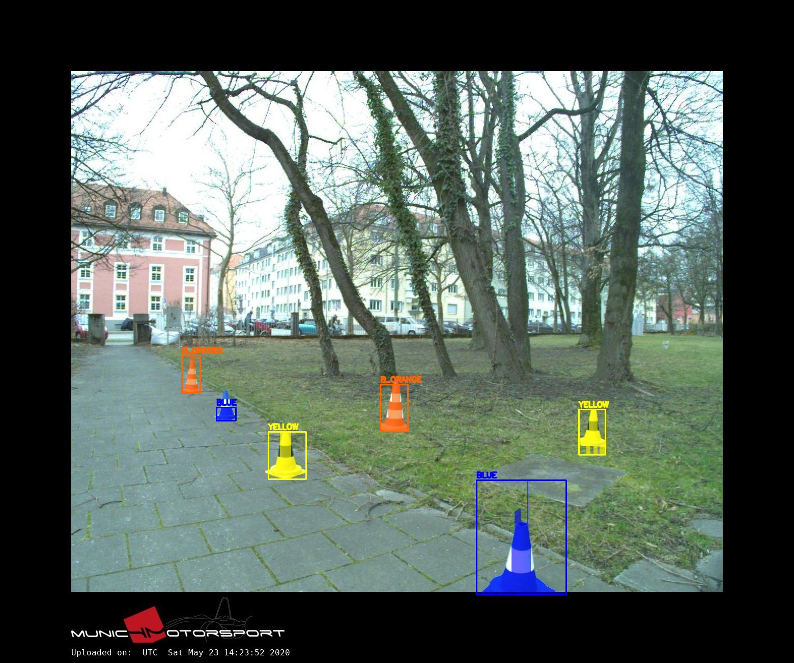
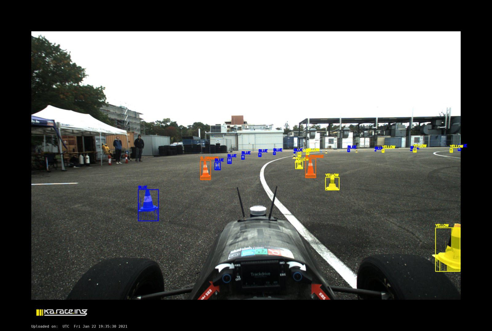

# Cone detection for Formula Student images

Detection, classification and segmentation of track cones (blue, yellow, small orange, large orange) on images from the [FSOCO](https://www.fsoco-dataset.com/) dataset, written in C++ with OpenCV and no deep learning.




The full write-up is in [CV_Report.pdf](CV_Report.pdf).

## How it works

1. **Candidate generation**: after a white balance, an HSV mask marks blue, yellow and orange pixels. Seven boxes of fixed heights are placed around each colour blob, which gives about 20k candidates per image.
2. **Two-stage classification**: each candidate becomes a 16×24 patch described by HOG plus a hue-saturation histogram. A linear SVM rejects most candidates, then an RBF SVM decides on the rest. Non-maximum suppression merges duplicates.
3. **Colour classification**: the class comes from counting coloured pixels in the box. Large and small orange cones are told apart by counting the white stripes.
4. **Segmentation**: k-means (K = 3) in HSV on the padded box. The cluster that matches the class colour is the cone, and a morphological closing joins the parts split by the stripes.
5. **Final box**: the bounding box of the mask.

## Results

On the test set (24 images, 398 cones):

| Metric | Value |
|---|---|
| Macro-averaged F1 (IoU ≥ 0.5) | 0.543 |
| mAP@0.5:0.95 | 0.165 |
| mIoU (pixels) | 0.294 |

## Build

Requires CMake ≥ 3.16, a C++17 compiler, OpenCV and zlib.

```
mkdir build
cd build
cmake ..
make
```

Run everything from inside `build/`, because all paths are relative to the project root.

## Usage

The trained models are already in `data/`, so evaluating does not require training.

```
./main eval                                   # F1, mAP and mIoU on the test set
./main testset                                # draws boxes and masks, saved in data/detect_test
./main detect ../path/to/image.png out.png    # run on a single image
```

Expected layout:

```
cones-detection/
  data/svm_hog_sgd_proposal.yml       linear stage
  data/svm_stage2_rbf_balanced.yml    RBF stage
  segmentation_test/img/              the 24 test images
  segmentation_test/ann/              their JSON annotations
  build/
```

`segmentation_test/` can also stay inside a `test_set/` folder.

## Training

You only need this to rebuild the models. Unzip `fsoco_bounding_boxes_train/` and `fsoco_segmentation_train/` in the project root, then:

```
./main dataset           # merges the two archives into dataset/ (test images are skipped)
./main csv ../dataset    # writes the ground-truth boxes to data/dataset.csv
./main train             # extracts the patches and trains both stages
```

`main train` overwrites the two `.yml` models and writes about 6 GB of patches to `data/patches/`, which you can delete afterwards. With a different OpenCV build the results can differ by a few hundredths. The shipped models always give the numbers above.

## Authors

Edin Milenko, Alessandro Martini, Nicola Ranzolin
